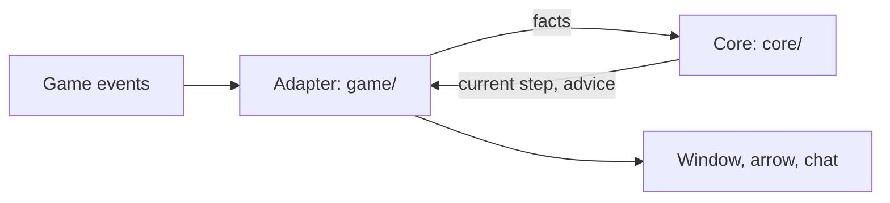

# TrailMate

A leveling coach for **World of Warcraft: Forever** (game version 1.60, interface 16001). It turns your quest log into steps with an arrow, tells you what to learn at the class trainer and what to sell, keep or auction at a vendor, and explains why.

**It advises, it never plays.** TrailMate does not press keys, move your character, buy, sell or train anything. It reads the game and shows text and an arrow; every action is yours.

> Status: early development. Screenshots arrive with version 0.1.0. Not affiliated with Blizzard Entertainment.

## What it does today

| Feature | How |
|---|---|
| Steps from your quest log | `/tm questlog` builds a route like a leveling guide: turn in what is complete, pick up the nearby quests the map shows, do everything nearest first, then turn it all in. Steps tick themselves off from game events, and the plan rebuilds itself when it ends or when you pick up a new quest. |
| Arrow | TrailMate's own arrow points at the current step (quest giver, objective area or turn-in) with the distance, using your facing. It also marks the spot on the map, through [TomTom](https://www.curseforge.com/wow/addons/tomtom) when it is installed or the game's own map pin otherwise. |
| Trainer advice | When you open a class trainer: a numbered list with *learn*, *skip* or *later* for each spell, and the reason. Ignore a spell once (`/tm ignore 3`) and it is never recommended again, in any rank. At each level-up it tells you only what just unlocked. Keeps a gold reserve you choose. |
| Vendor advice | When you open a vendor: what to sell (and roughly for how much), what to keep, and what is worth the auction house. Warns when your bags are almost full. |
| Character summary | `/tm status`: class, level, XP, gold, position, quests and bag space. No names are stored. |
| More with QuestieDB (optional) | If the [QuestieDB](https://github.com/Questie/QuestieDB) addon is installed, TrailMate reads its public API while you play: places for quests the game gives no location for, nearby quests that fit your level, race and class as pick-up steps, and `/tm find trainer` to point the arrow at your class trainer. TrailMate never copies or ships QuestieDB's data. |

## Install

1. Copy the `TrailMate` folder into `World of Warcraft/_forever_/Interface/AddOns/`.
2. Restart the game or type `/reload`.
3. Type `/tm` to see the commands. English and Spanish commands both work (`/tm questlog` or `/tm diario`).

## Commands

| Command | What it does |
|---|---|
| `/tm questlog` · `/tm diario` | Build a plan from your quest log |
| `/tm skip` · `/tm salta` | Skip the current step |
| `/tm done` · `/tm hecho` | Mark the current step as done |
| `/tm undo` · `/tm deshaz` | Undo the last mark |
| `/tm trainer` · `/tm instructor` | Advice at the open trainer |
| `/tm ignore <n\|name>` · `/tm ignorar` | Never recommend that spell again (all ranks) |
| `/tm learned <n\|name>` · `/tm aprendido` | Stop reminding a spell you already have |
| `/tm unignore <name>` · `/tm recuperar` | Recommend an ignored spell again |
| `/tm ignored` · `/tm ignorados` | List ignored spells |
| `/tm arrow on\|off` · `/tm flecha si\|no` | Show or hide the arrow |
| `/tm auto on\|off` | Rebuild the plan by itself when it ends |
| `/tm vendor` · `/tm vender` | What to sell, keep or auction |
| `/tm status` · `/tm estado` | Character summary |
| `/tm tracking on\|off` · `/tm rastreos si\|no` | Learn or skip hunter tracking spells |
| `/tm reserve <gold>` · `/tm reserva <oro>` | Gold the trainer advice never spends |
| `/tm show` / `/tm hide` | Show or hide the window |
| `/tm clear` · `/tm borrar` | Remove the plan |
| `/tm find trainer` · `/tm buscar instructor` | Arrow to the nearest trainer of your class (needs QuestieDB) |
| `/tm plan` | Arrow back to the plan |
| `/tm diag` | What this client exposes, for bug reports (no personal data) |

## How it works



- `TrailMate/core/` is plain Lua 5.1 with no game API: the plan format and its validator, the step engine, the quest-log planner and the trainer and bag advisors. It is fully tested outside the game.
- `TrailMate/game/` is a thin adapter: it reads the game, turns events into facts and draws the window. Every game function is feature-detected, because this client is new.
- A plan is **pure data** and is validated every time it is loaded. Later versions receive plans written by an external program, so a plan can never carry code.

## Development

Requires Lua 5.1 and LuaRocks.

```bash
luarocks install --local busted 2.3.0-1
luarocks install --local luacheck 1.2.0-1
luacheck .
busted
```

## Roadmap

- 0.1.0: installable release, screenshots.
- Bridge program and Claude: a plan for the next hours prepared from your character's state, delivered to the game as validated data.
- Measured accuracy and cost of the advice.

## Limitations

- Arrival at a place is approximate: zones have different sizes and the radius is in map units.
- Trainer rules are generic plus hunter tracking; class-specific advice grows over time.
- Without QuestieDB, TrailMate only knows what the game shows: your quest log and quest areas. On WoW Forever the game does not tell addons about quests you have not picked up yet.
- With QuestieDB, looking for nearby quests and for trainers reads the whole database, which can cause a short stutter when the plan is rebuilt.
- The vendor advice uses item level as a rough guide for gear, not stats.

## Related work

[Azeroth Companion](https://github.com/nardo86/azeroth-companion) (MIT) pioneered the addon-plus-desktop-app pattern for in-game AI chat. TrailMate is a coach rather than a chat, and works without any AI.

## License

[MIT](LICENSE).
